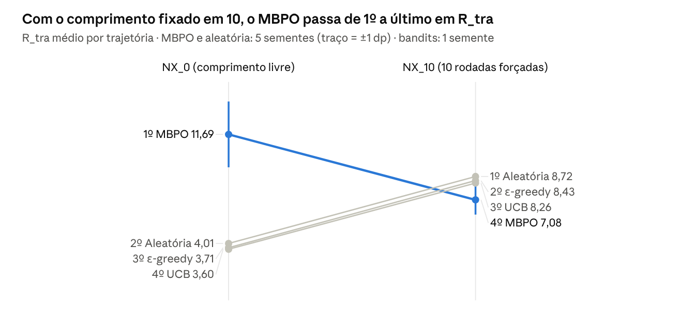

# **Experimentos em RLRS — Avaliação e Bolhas (Semana 8\)**

Oct 29, 2026 · @Gabriel Orlow de Oliveira Sene

## **Pergunta orientadora e mapa dos experimentos**

A pergunta orientadora é: **quais sinais usados são influentes para avaliar um sistema de recomendação baseado em reforço?** Nesta semana, ela foi decomposta em três tipos de sinal, e cada experimento examina um deles.

* **Sinais de treino:** o que a política maximiza. São a predição do modelo de usuário (r̂), a penalidade de incerteza (P\_U) e o termo de entropia (P\_E).  
* **Regras do simulador:** o que encerra a sessão. É a regra de saída do usuário simulado.  
* **Métricas e protocolos de avaliação:** o que é medido (R\_tra, R\_each, Length, MCD) e sob quais condições (FB, NX\_0, NX\_10).

Na decomposição da Justificativa de Replicação (objeto, mecanismo, condição), S1, S2 e E2 tratam do mecanismo; E1 trata da condição; S3 trata da medição do objeto.

| Experimento | Sinal examinado | Pergunta | Status |
| ----- | ----- | ----- | ----- |
| R — Reprodução (MBPO, MOPO, DORL) | Treino (P\_U, P\_E) | As afirmações da Tabela 2 se mantêm entre sementes? | Parcial |
| S1 — Diagnóstico do P\_E | Treino (P\_E) | Quanto do P\_E é sinal e quanto é preenchimento? | Concluído |
| S2 — r̂ × avaliação | Treino × avaliação | O r̂ prevê a recompensa usada na avaliação? | Concluído |
| S3 — Política aleatória | Métricas | Qual é o desempenho de uma política sem nenhum sinal? | Concluído |
| E1 — Inversão por protocolo | Métricas e protocolos | A ordem dos métodos depende do protocolo e da métrica? | Parcial |
| P — Registro do P\_E no treino | Treino (P\_E) | Que valores o P\_E assume nas trajetórias da política treinada? | Pendente |
| E2 — Ablação do P\_E | Treino (P\_E) | O ganho do DORL vem da variação do P\_E ou do seu valor médio? | Pendente |

## **Configuração comum**

Todos os experimentos usam o KuaiRec e o código do DORL (DORL-codes, commit `818c9bd`; fork do tianshou `0f59e38`). A única alteração no código é o patch de registro da seção P, inativo sem a variável de ambiente correspondente.

| Componente | Configuração |
| ----- | ----- |
| Dados de treino | big\_matrix: 12.530.806 interações |
| Dados de avaliação | small\_matrix: 1.411 usuários × 3.327 itens, 4.676.570 interações; 17.827 células ausentes valem 0 |
| Modelo de usuário | Ensemble de DeepFM; alvo `watch_ratio_normed` (watch\_ratio padronizado por vídeo) |
| Recompensa de avaliação | `watch_ratio` bruto do small\_matrix, limitado a 5 |
| Usuário simulado | Sai quando o item recomendado compartilha categoria com os 4 anteriores (N \= 4, M \= 0); no máximo 30 rodadas |
| Treino das políticas | A2C, 200 épocas, 100 trajetórias de teste por época |
| Hardware | RTX 4090 (treino das políticas); MacBook M3 Pro (análises sem treino) |

**Métodos.** Os três métodos de RL compartilham o modelo de usuário e diferem apenas nos pesos das penalidades. Os argumentos foram tirados dos logs originais dos autores, não do README do repositório.

| Método | λ₁ (P\_U) | λ₂ (P\_E) | Observação |
| ----- | ----- | ----- | ----- |
| MBPO | 0 | 0 | Sem penalidades |
| MOPO | 0,05 | 0 | Penalidade de incerteza |
| DORL | 0,05 | 5 | Incerteza \+ entropia |
| DORL-const (E2) | 0,05 | 5 | P\_E substituído por uma constante |
| UCB, ε-greedy | — | — | Bandits do artigo |
| Aleatória (S3) | — | — | Item uniforme; reimplementação validada |

A recompensa que a política maximiza no ambiente simulado é:

\\tilde r \= \\max\\left(0,\\; \\hat r \- \\lambda\_1 P\_U \+ \\lambda\_2 P\_E \- \\mathrm{MIN\\\_R}\\right), \\qquad \\mathrm{MIN\\\_R} \= \\min \\hat r \- \\lambda\_1 \\max P\_U \+ \\lambda\_2 \\min P\_E

**Protocolos de avaliação** (`collector_set.py`):

| Protocolo | Repetição de itens | Regra de saída |
| ----- | ----- | ----- |
| FB | Permitida | Ativa |
| NX\_0 (Tabela 2\) | Proibida | Ativa |
| NX\_10 | Proibida | Ignorada; trajetória forçada a 10 rodadas |

**Métricas**, calculadas por época sobre 100 trajetórias:

* **Length:** passos por trajetória.  
* **R\_tra:** recompensa acumulada por trajetória.  
* **R\_each:** R\_tra ÷ Length, a recompensa média por passo.  
* **MCD:** fração dos itens recomendados com alguma categoria dominante. No KuaiRec são 10 categorias, lidas do `feature_domination.pickle` distribuído com o código. Quanto menor, menor a concentração.

**Agregação.** Em cada semente, cada métrica é a média sobre as 200 épocas, como na Tabela 2\. Entre sementes, reporta-se média ± desvio padrão e o número de sementes (n). O ± da Tabela 2 é a dispersão entre épocas de uma execução e não é comparável ao desvio entre sementes.

## **Achados da leitura do código**

A leitura do código mostrou seis pontos em que a implementação determina o resultado tanto quanto o método. Cada experimento desta semana parte de um ou mais deles.

| \# | Achado | Onde no código | Motiva |
| ----- | ----- | ----- | ----- |
| A1 | O usuário simulado sai quando repete categoria. Por construção, Length e R\_tra medem em parte a não repetição de categorias, e não a preferência. R\_each é a única métrica sem esse vínculo mecânico. | `KuaiEnv._determine_whether_to_leave` | E1, S3 |
| A2 | O P\_E é calculado sobre itens, não sobre categorias: é a entropia normalizada do próximo item nos logs, condicionada ao último item (k \= 1\) e ao par dos dois últimos (k \= 2). Histórico ausente da tabela vale 1, o máximo. Histórico com uma única continuação observada também vale 1\. No passo t \= 0, soma-se 1 pelo par inexistente. | `user_model_ensemble.get_save_entropy_mat`; `simulated_env._compute_pred_reward` | S1, P, E2 |
| A3 | A recompensa é deslocada por −MIN\_R e limitada em 0, então todo passo tem recompensa não negativa. Cada passo a mais acrescenta recompensa: há um bônus por sobrevivência embutido. No DORL, o termo de entropia de MIN\_R usa a soma dos mínimos da tabela (0,291). | `simulated_env.py`; `run_Policy_Main.py` | S1, E2 |
| A4 | Alvo de treino e recompensa de avaliação são sinais diferentes: o modelo aprende o watch\_ratio padronizado por vídeo, e a avaliação usa o watch\_ratio bruto limitado a 5\. A média e o desvio de cada vídeo são calculados juntando big\_matrix e small\_matrix, então dados de avaliação entram na normalização do alvo de treino. | `preprocessing_kuairec.py`; `KuaiEnv.load_mat` | S2 |
| A5 | A janela da regra de saída encolhe nos primeiros passos. Com N \= 4, no passo t \= 3 só o item anterior é comparado, por causa do fatiamento `sequence_action[t−N:t]` com índice negativo. Com N maior, mais passos são afetados. | `KuaiEnv._determine_whether_to_leave` | E3 (adiado) |
| A6 | A MCD do KuaiRec usa 10 categorias dominantes, e não 12 como consta na Justificativa de Replicação. | `environments/KuaiRec/env/feature_domination.pickle` | Correção na Justificativa |

## **R — Reprodução: MBPO, MOPO e DORL com 5 sementes**

No MBPO, a média de 5 sementes reproduz a Tabela 2 de perto. Mas a variação entre sementes é maior que algumas diferenças que o artigo interpreta. MOPO e DORL estão em fechamento.

**Pergunta.** As afirmações da Tabela 2 se mantêm quando se considera a variação entre sementes?

**Justificativa.** O ± da Tabela 2 é a dispersão entre épocas de uma execução. Os nomes dos logs originais (`_s2`, `_s4`) sugerem que os autores rodaram várias sementes e reportaram uma. Sem a média entre sementes, não se sabe se uma diferença entre métodos supera o ruído de semente. A reprodução também serve de base funcional para os demais experimentos.

**Comparações e o que cada uma testa.**

| Comparação | Afirmação testada |
| ----- | ----- |
| DORL × MBPO em Length e R\_tra | Afirmação principal: a entropia aumenta o comprimento da sessão |
| MOPO × MBPO em MCD | C1: o conservadorismo por incerteza aumenta a concentração (efeito Mateus) |
| DORL × MOPO | Efeito isolado do P\_E, o único termo que difere entre os dois |

**Procedimento.** Sementes 0 a 4, com os comandos da seção 6 do README do repositório. A tabela é gerada pelo `e1_protocolos.py` (seção NX\_0). Critério: uma diferença entre métodos conta como reproduzida quando supera o maior desvio padrão entre sementes dos dois métodos.

**Resultado (NX\_0).**

| Fonte | R\_tra | R\_each | Length | MCD |
| ----- | ----- | ----- | ----- | ----- |
| MBPO — 5 sementes | 11,69 ± 2,32 | 0,736 ± 0,071 | 15,78 ± 1,83 | 0,323 ± 0,061 |
| MBPO — Tabela 2 | 12,04 ± 1,31 | 0,770 ± 0,029 | 15,65 ± 1,64 | 0,362 ± 0,047 |
| MOPO — 5 sementes | pendente | pendente | pendente | pendente |
| MOPO — Tabela 2 | 11,43 ± 1,75 | 0,892 ± 0,051 | 12,81 ± 1,85 | 0,479 ± 0,062 |
| DORL — 5 sementes | a tabular | a tabular | a tabular | a tabular |
| DORL — Tabela 2 | 20,49 ± 2,67 | 0,767 ± 0,026 | 26,71 ± 3,42 | 0,379 ± 0,015 |

**Interpretação (MBPO).**

* A média entre sementes fica dentro de um desvio do artigo em R\_tra, Length e MCD. Em R\_each, a diferença (0,034) fica pouco acima de um desvio (0,029).  
* O desvio da MCD entre sementes (0,061) é 3,6 vezes a diferença DORL − MBPO da Tabela 2 (0,017). Diferenças dessa ordem não são distinguíveis com uma semente.  
* A semente 2, a usada pelos autores, é a única a menos de um desvio do artigo nas quatro métricas. Isso é compatível com seleção de semente, mas não a demonstra.

**Limitações.** Cinco sementes por método; um único modelo de usuário, sem repetir o seu treino.

## **S1 — Diagnóstico do termo de entropia (P\_E), sem treino**

Sob duas políticas de referência, o P\_E responde por cerca de 99% da variação da recompensa do DORL (correlação de 0,996 a 0,998 entre r̃ e λ₂·P\_E). O termo de pares (k \= 2\) é praticamente constante.

**Pergunta.** Quanto do P\_E é sinal e quanto é preenchimento automático com 1? E qual é o seu peso na recompensa, comparado com r̂ e com P\_U?

**Justificativa.** O artigo motiva o P\_E como diversidade da política de log (Eq. 8). Pelos achados A2 e A3, porém, consultas não observadas valem o máximo, e a recompensa é sempre positiva. Se a maior parte das consultas cair no preenchimento, o P\_E funciona como bônus quase constante por passo, e não como sinal de diversidade.

**Procedimento.** O `diagnostico_pe.py` reconstrói a tabela de entropia a partir do big\_matrix com as mesmas regras do código. Em dados sintéticos, a tabela e o P\_E por passo são idênticos aos de uma cópia literal do código original. O script simula 20.000 trajetórias de 30 passos sobre os 3.327 itens do small\_matrix, sob duas políticas: uniforme e proporcional à popularidade no log. A escala de λ₂·P\_E é comparada com a de r̂ e λ₁·P\_U, usando as matrizes salvas pelo modelo de usuário (λ₁ \= 0,05; λ₂ \= 5).

**Resultado: a tabela de entropia.**

| Medida | k \= 1 (último item) | k \= 2 (par dos dois últimos) |
| ----- | ----- | ----- |
| Históricos na tabela | 10.726 | 4.340.472 |
| Com uma única continuação (valem 1 por regra) | 2,7% | 49,4% |
| Com valor igual a 1 | 15,9% | 96,3% |
| Mediana | 0,962 | 1,0 |

**Resultado: o P\_E sob as políticas de referência** (passos t ≥ 1).

| Medida | Uniforme | Por popularidade |
| ----- | ----- | ----- |
| Consultas de par ausentes da tabela (valem 1\) | 52,7% | 45,0% |
| P\_E médio (máximo 2\) | 1,909 | 1,896 |
| Desvio padrão de r̂ | 0,022 | 0,023 |
| Desvio padrão de λ₁·P\_U | 0,012 | 0,013 |
| Desvio padrão de λ₂·P\_E | 0,239 | 0,302 |
| Correlação entre r̃ e λ₂·P\_E | 0,996 | 0,998 |
| r̃ médio por passo | 8,62 | 8,55 |

A correlação de Spearman entre a popularidade do item e o seu P\_E de k \= 1 é −0,53.

**Interpretação.**

1. O termo k \= 2 é quase constante. Cerca de metade das consultas não encontra o par, e 96% dos pares encontrados valem 1\. Na prática, ele soma cerca de \+1 por passo (+5 na recompensa).  
2. A variação vem do termo k \= 1 e favorece itens raros. Hipótese a verificar: um item raro tem poucas continuações, cada uma vista uma vez, e nesse caso a entropia normalizada vale 1 por construção.  
3. O desvio de λ₂·P\_E é 11 a 14 vezes o de r̂. A recompensa média por passo é 28 a 36 vezes a sua variação entre ações. Prolongar a trajetória vale mais que escolher um item melhor, o que é coerente com o ganho do DORL aparecer em Length.

**Limitações.** Políticas de referência, não a política treinada (ver P). Valores de λ fixos nos do artigo.

## **S2 — r̂ do modelo de usuário × recompensa de avaliação, sem treino**

Os 10 itens com maior r̂ recebem, na avaliação, menos da metade da recompensa de itens escolhidos ao acaso. Toda a capacidade de ordenar vem da média do vídeo, que o alvo de treino remove.

**Pergunta.** O r̂, que a política maximiza, prevê a recompensa usada na avaliação?

**Justificativa.** Pelo achado A4, o modelo aprende o watch\_ratio padronizado por vídeo, e a avaliação usa o watch\_ratio bruto. Se a diferença entre vídeos explica boa parte da recompensa de avaliação, o sinal de treino perde justamente o que a avaliação premia.

**Procedimento.** O `r_hat_vs_avaliacao.py` monta a matriz de avaliação exatamente como o `KuaiEnv.load_mat`, o que foi verificado contra uma cópia literal da função. Para cada usuário, ordena os 3.327 itens por quatro critérios e mede a recompensa de avaliação média dos 10 primeiros:

* o r̂, como sai do modelo;  
* o r̂ devolvido à escala original, com média e desvio de cada vídeo calculados só no big\_matrix, sem dados de avaliação;  
* só a média do vídeo, sem personalização;  
* o oráculo, que é a própria recompensa de avaliação.

| Medida complementar | Valor |
| ----- | ----- |
| Correlação global entre r̂ e a avaliação (Pearson / Spearman) | 0,083 / 0,086 |
| Spearman por usuário, mediana: r̂ / r̂ na escala original / média do vídeo | 0,075 / 0,674 / 0,673 |
| Variância da avaliação explicada pela média do vídeo / do usuário | 27,5% / 5,1% |
| Correlação entre a média do vídeo no big\_matrix e no small\_matrix | 0,977 |
| Desvio padrão de r̂ / da recompensa de avaliação | 0,022 / 0,661 |

**Interpretação.**

1. O r̂ sozinho escolhe itens piores que o acaso. A padronização por vídeo retira do alvo o efeito do vídeo, que explica 27,5% da variância da avaliação.  
2. A parte personalizada do r̂ não acrescenta nada à média do vídeo: 2,30 contra 2,33 no top-10, e 0,674 contra 0,673 em Spearman.  
3. Junto com a S1: nem a recompensa do MBPO (r̂) nem a do DORL (quase toda P\_E) carregam o sinal que a avaliação mede.

**Limitações.** Análise estática: ignora a sequência, a proibição de repetir itens e a regra de saída.

## **S3 — Política aleatória como referência sem sinal**

Uma política que escolhe itens ao acaso supera os dois bandits em R\_tra, R\_each e Length. O R\_each do MBPO (0,736) fica abaixo do dela (0,872).

**Pergunta.** Qual é o valor de cada métrica quando a política não usa nenhum sinal?

**Justificativa.** A Tabela 2 não tem referência sem sinal. Sem ela, não se sabe se um R\_each ou uma MCD é alto ou baixo, nem quanto do Length vem apenas da regra de saída (A1). A política uniforme mede o que o ambiente produz por si.

**Procedimento.** O `politica_aleatoria.py` reimplementa o ambiente de avaliação: a matriz de recompensa, a regra de saída (inclusive o recorte A5), os três protocolos, as métricas e a agregação em 200 épocas de 100 trajetórias. Em dados sintéticos, trajetórias, recompensas e MCD são idênticas às de cópias literais do `KuaiEnv` e do avaliador. Foram 5 sementes. A política não passou pelo pipeline do DORL.

**Resultado (NX\_0).**

| Método | n | R\_tra | R\_each | Length | MCD |
| ----- | ----- | ----- | ----- | ----- | ----- |
| Aleatória | 5 | 4,01 ± 0,02 | 0,872 ± 0,001 | 4,60 ± 0,02 | 0,828 ± 0,001 |
| UCB | 1 | 3,60 | 0,857 | 4,19 | 0,822 |
| ε-greedy | 1 | 3,71 | 0,857 | 4,31 | 0,813 |
| UCB — Tabela 2 | — | 3,61 | 0,853 | 4,22 | 0,811 |
| ε-greedy — Tabela 2 | — | 3,52 | 0,828 | 4,22 | 0,823 |

Nos protocolos FB e NX\_10, a política aleatória tem R\_each de 0,873 e 0,872 e MCD de 0,827 nos dois.

**Interpretação.**

1. **Os bandits não superam o acaso.** Ficam abaixo da política aleatória em R\_tra, R\_each e Length, tanto na sua execução quanto na dos autores.  
2. **O R\_each do MBPO fica abaixo do acaso,** por cerca de dois desvios entre sementes (seção R). Na Tabela 2, MBPO (0,770) e DORL (0,767) também ficam abaixo; só o MOPO (0,892) fica acima. A vantagem do RL em R\_tra vem do Length.  
3. **A MCD de referência é 0,83.** É a taxa de base: as 10 categorias dominantes cobrem a maior parte dos itens. Os métodos de RL ficam muito abaixo (0,32 a 0,48), ou seja, recomendam menos itens dessas categorias que o acaso. Hipótese a verificar: categorias frequentes repetem categoria na janela mais facilmente e encerram a sessão; evitá-las prolonga a trajetória.  
4. **Consequência para a MCD.** O efeito Mateus da Tabela 2 (MOPO 0,479 contra MBPO 0,362) é medido entre métodos que estão todos abaixo da taxa de base. A concentração só tem significado relativo a essa referência.

**Limitações.** Bandits com uma semente cada (cada execução leva cerca de 8 h 40 min). Reimplementação fora do pipeline, validada apenas em dados sintéticos.

## **E1 — Inversão por protocolo e por métrica**

Resultado parcial, sem MOPO e DORL: quando o comprimento da sessão é fixado, o MBPO passa de melhor a pior em R\_tra. Nos três protocolos, ele tem o pior R\_each.

**Pergunta.** A ordem dos métodos depende do protocolo de avaliação e da métrica escolhida?

**Justificativa.** Pelo achado A1, no NX\_0 o Length depende da regra de saída, e o R\_tra herda essa dependência. Os outros dois protocolos isolam partes do efeito:

* **NX\_10** fixa o comprimento em 10\. O R\_tra passa a ser 10 × R\_each e mede só a recompensa por passo.  
* **FB** permite repetir itens. Mostra o que cada política faz quando pode explorar a regra de saída sem a restrição de novidade.

Os logs do DORL já registram os três protocolos, então o E1 não exige novas execuções.

**Procedimento.** O `e1_protocolos.py` lê os logs com a mesma agregação da Tabela 2 e inclui a política aleatória com `--aleatoria aleatoria.json`. Ele ordena os métodos em cada protocolo e métrica e lista os pares cuja ordem muda. Uma inversão conta como robusta quando a diferença, nos dois cenários comparados, supera o maior desvio entre sementes.

**Resultado parcial.**

* **R\_tra, NX\_0 → NX\_10:** o MBPO passa de 1º a 4º. No NX\_10, a diferença para a aleatória (1,65) supera o desvio do MBPO entre sementes (1,04).  
* **R\_each:** o MBPO é o pior nos três protocolos.  
* **MCD:** o MBPO tem a menor concentração nos três protocolos.  
* **FB:** o MBPO dura 27,6 passos (de no máximo 30), contra 4,6 da aleatória, 3,2 do UCB e 2,7 do ε-greedy. Os bandits, que tendem a repetir os mesmos itens, saem antes do acaso. A duração do MBPO motiva o item 2 do planejamento.

**Interpretação.** A vantagem do MBPO na Tabela 2 é de duração da sessão, não de recompensa por passo: ela desaparece e se inverte quando o protocolo neutraliza a regra de saída.

**Pendente.** Incluir MOPO e DORL com 5 sementes e, depois, o DORL-const do E2.

## **P — Registro do P\_E durante o treino do DORL**

O registro mede o P\_E nas trajetórias que a política do DORL de fato gera e fornece a constante do E2. Resultado pendente.

**Pergunta.** Que valores o P\_E assume ao longo do treino, e quanto deles é preenchimento?

**Justificativa.** A S1 usa políticas de referência. A política treinada pode concentrar-se em regiões da tabela de entropia diferentes, com mais ou menos consultas ausentes. A medida definitiva do papel do P\_E exige registrá-lo durante o treino.

**Procedimento.**

1. Aplicar o `pe_log.patch` ao DORL-codes. Com a variável `PE_LOG`, o ambiente simulado grava a cada passo de treino: o P\_E calculado, o número de consultas ausentes, o preenchimento em t \= 0, r̂, P\_U e a recompensa penalizada. Sem a variável, a recompensa é idêntica à do código original (testado).  
2. Rodar uma semente (s2) com os mesmos argumentos do DORL. Uma semente basta, porque se trata de uma medição, não de uma comparação entre métodos.  
3. Resumir com o `analisa_pe_log.py`, por quintil do treino.

**O que reportar.**

| Medida | Para quê |
| ----- | ----- |
| Fração de consultas ausentes da tabela | Quanto do P\_E é preenchimento na política treinada |
| Desvio de λ₂·P\_E contra o de r̂ | Qual termo domina a variação da recompensa |
| Correlação entre P\_E e r̂ | Se os dois sinais apontam na mesma direção |
| Média do P\_E no último quintil | Constante usada no E2 |

**Resultado.** Pendente.

## **E2 — Ablação do P\_E: DORL com P\_E constante**

O E2 separa os dois efeitos possíveis do P\_E: o seu valor médio, que define quanto vale cada passo, e a sua variação, que define qual item é premiado. Resultado pendente.

**Pergunta.** O ganho do DORL sobre o MOPO vem da variação do P\_E entre ações, ou apenas do bônus médio que ele soma a cada passo?

**Justificativa.**

* O artigo sustenta que a entropia reintroduz exploração (C4, Fig. 8), mas só varia λ₂ e não separa diversidade de bônus por passo.  
* A S1 indica que o P\_E é quase constante e domina a recompensa, o que favorece a leitura de bônus por sobrevivência.  
* Os trabalhos que usam o DORL como base (ROLeR, CIKM 2024; DARLR, SIGIR 2025\) mantêm o termo sem analisá-lo.

**Desenho.** O DORL-const é o DORL com o P\_E substituído por uma constante c (variável `PE_CONST` do mesmo patch). O valor c é a média do P\_E no último quintil do registro P. O MIN\_R não muda, então cada passo recebe o bônus fixo λ₂·(c − 0,291). A comparação se decompõe em dois passos, cada um com uma única mudança:

1. **MOPO → DORL-const:** acrescenta só um bônus fixo por passo.  
2. **DORL-const → DORL:** acrescenta só a variação do P\_E entre ações.

**Procedimento.** Cinco sementes (0 a 4), mesmos argumentos do DORL, mensagens `DORLconst_s0` a `DORLconst_s4`. Cerca de 4 h na RTX 4090\. As quatro métricas são reportadas em NX\_0 para MOPO, DORL-const e DORL.

**Leitura do resultado.** "Igual" significa diferença menor que o maior desvio entre sementes.

| Se, em Length e R\_tra… | Leitura |
| ----- | ----- |
| DORL-const igual ao DORL | O ganho vem do bônus por passo, não da diversidade |
| DORL-const igual ao MOPO | O ganho depende da variação do P\_E |
| DORL-const entre os dois | Os dois efeitos contribuem; reportar a fração de cada um |

A MCD dos três métodos indica se a variação do P\_E muda a concentração, lida contra a taxa de base de 0,83 (S3).

**Resultado.** Pendente; depende da constante do registro P.

## **Síntese parcial**

Até aqui, as métricas da Tabela 2 no KuaiRec respondem mais à regra de saída e aos termos de recompensa do que à preferência estimada do usuário. A síntese é provisória: apoia-se no MBPO e nas análises sem treino, e MOPO, DORL, P e E2 podem confirmá-la ou não.

| Tipo de sinal | O que os resultados indicam | Base |
| ----- | ----- | ----- |
| Treino | O r̂ não ordena os itens como a avaliação; no DORL, ele pesa pouco diante do P\_E | S2, S1 |
| Regra do simulador | A vantagem do RL em R\_tra vem do Length; em R\_each, o MBPO fica abaixo do acaso | S3, R |
| Protocolo | Com o comprimento fixado (NX\_10), a ordem dos métodos em R\_tra se inverte | E1 |
| Métrica | A MCD só tem significado diante da taxa de base de 0,83 | S3 |

Esses pontos se alinham à direção do TCC: mostrar como efeitos do tipo Mateus aparecem, ou são mal medidos, quando boas práticas de avaliação não são seguidas.

## **Limitações gerais**

As conclusões valem para um único conjunto de dados e um simulador com regra de saída artesanal, sem usuários reais.

* Os bandits têm uma semente cada.  
* S1 e S2 são análises estáticas ou com políticas de referência, não com as políticas treinadas.  
* A política aleatória é uma reimplementação, validada contra cópias do código apenas em dados sintéticos.  
* A MCD é agregada sobre todos os usuários e não mede concentração individual (bolha).  
* A normalização do alvo de treino usa dados de avaliação (A4).  
* Os pesos λ₁ e λ₂ ficaram nos valores do artigo; não houve varredura.  
* O recorte da janela da regra de saída (A5) está presente em todas as execuções, inclusive nas dos autores.

## **Planejamento da próxima semana**

A próxima semana parte do pressuposto de que R, E1, P e E2 terminam nesta. Ela se concentra na "bolha" e no descompasso entre o sinal de treino e o de avaliação.

| \# | Item | Justificativa | Depende de | Critério |
| ----- | ----- | ----- | ----- | ----- |
| 1 | Registrar as trajetórias de avaliação (itens e categorias por passo) | A MCD agregada não mostra o que acontece dentro de cada sessão | — | Registro validado nos três protocolos |
| 2 | Investigar o protocolo FB | No FB, o MBPO dura cerca de 28 passos, contra 4,6 da política aleatória. Hipótese: a política alterna 5 ou mais categorias e nunca dispara a regra de saída | Item 1 | Hipótese confirmada ou descartada |
| 3 | "Bolha": definição operacional e métrica por trajetória sob NX\_10, relativa a uma referência (taxa de base ou distribuição de categorias do próprio usuário) | A MCD agregada não distingue bolha individual, e a S3 mostrou que concentração sem referência engana | Item 1 e leitura | Métrica definida e medida para MBPO, MOPO, DORL e aleatória |
| 4 | E5: treinar o modelo de usuário com o watch\_ratio bruto limitado a 5 e repetir MBPO e DORL | A4 e S2: treino e avaliação usam sinais diferentes. Exige uma pequena alteração no carregador do KuaiRec, que só lê `watch_ratio_normed` | — | A vantagem em Length e a ordem dos métodos mudam? |
| 5 | Relatório: esqueleto do texto e apêndice técnico com R, E1, E2 e as análises S1 a S3 | Defesa na primeira semana de dezembro | — | Esqueleto e apêndice revisáveis |

**Adiados, com motivo.**

* **E3 (sensibilidade à regra de saída):** o E5 responde mais diretamente à pergunta; o recorte A5 fica documentado.  
* **KuaiRand:** abrir um segundo conjunto de dados antes de fechar o primeiro dispersa o esforço.  
* **Mais sementes para os bandits:** cerca de 8 h 40 min por execução.

## **Artefatos e reprodutibilidade**

Todos os números deste documento vêm de arquivos no repositório [Residência](https://github.com/orlow04/Residencia). Commit desta versão: a preencher.

| Artefato | Conteúdo | Gera ou sustenta |
| ----- | ----- | ----- |
| `setup.sh`, `requirements.txt` | Ambiente: DORL-codes `818c9bd`, fork do tianshou `0f59e38`, Python 3.10 | Todos |
| `versions_venv.txt`, `dorl_commit.txt`, `dorl_codes_diff.patch` | Versões do ambiente virtual e prova de que a única alteração no código é o patch P | Todos |
| `pe_log.patch` | Registro do P\_E (`PE_LOG`) e constante do E2 (`PE_CONST`) | P, E2 |
| Logs em `export/saved_models/` | Execuções de MBPO, MOPO, DORL, DORL-const, UCB e ε-greedy | R, E1, E2 |
| `table2_from_log.py` | Resumo de um log no formato da Tabela 2 (reproduz exatamente os 40 valores do artigo a partir dos logs dos autores) | R |
| `e1_protocolos.py` → `e1_*.csv` | Tabela entre sementes, posições e inversões | R, E1 |
| `diagnostico_pe.py` → `pe_diag.json` | Diagnóstico do P\_E | S1 |
| `r_hat_vs_avaliacao.py` → `rhat_aval.json` | r̂ × recompensa de avaliação | S2 |
| `politica_aleatoria.py` → `aleatoria.json` | Política aleatória nos três protocolos | S3, E1 |
| `analisa_pe_log.py` → `pe_log_resumo.txt`; `pe_log_DORL_s2.csv.gz` | Resumo e registro bruto do P\_E | P |
| `mats.sha256` | Hash das matrizes do modelo de usuário (não versionadas; cerca de 38 MB cada) | S1, S2 |
