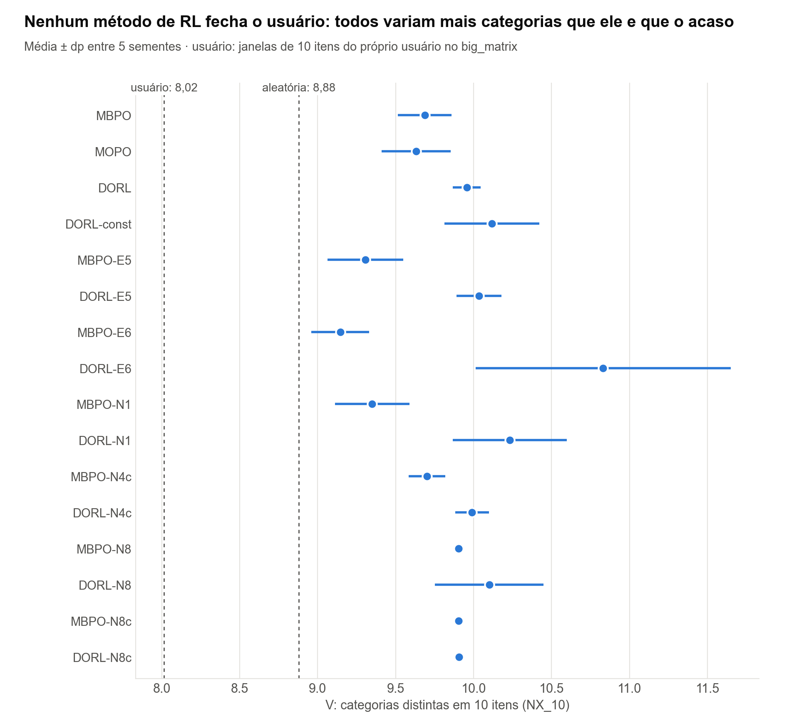
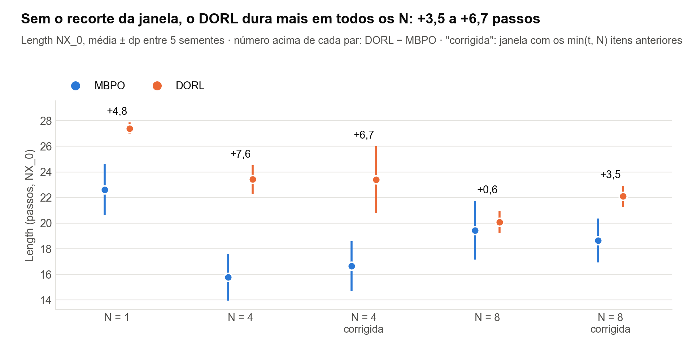
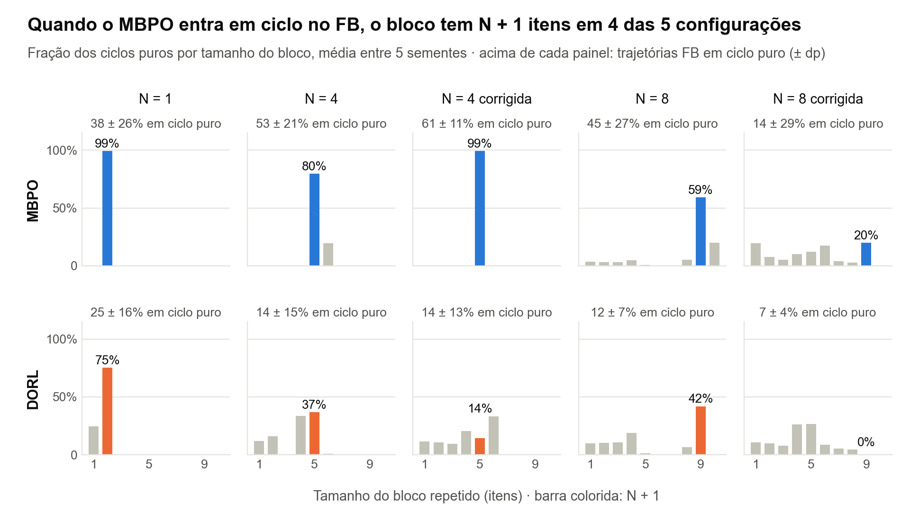
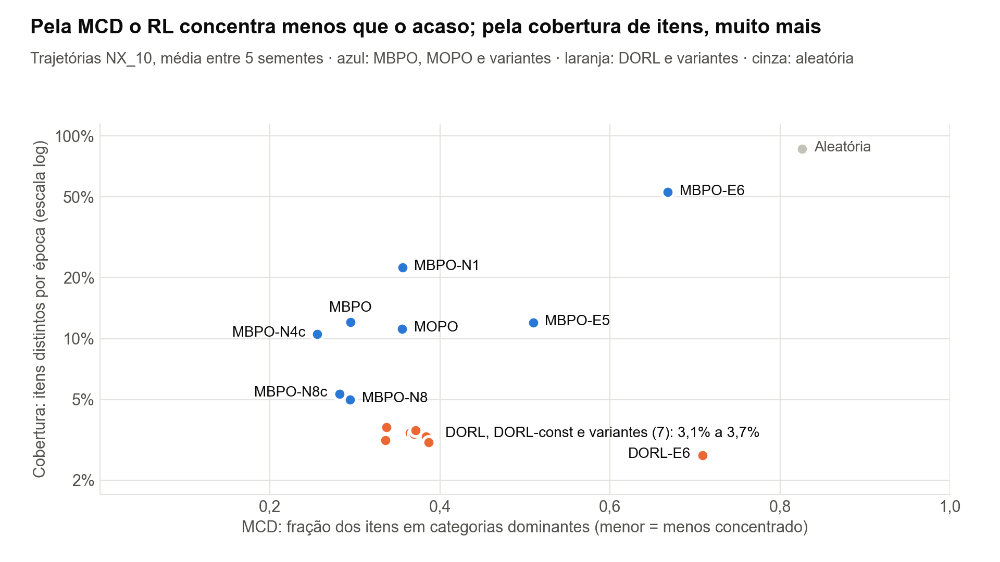
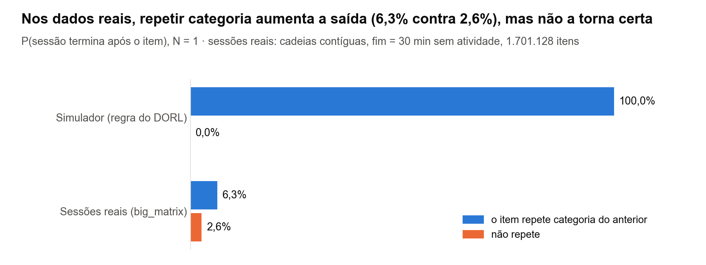

# Semana 9 — Da concentração agregada à bolha por usuário

Registro técnico da semana. Referências de código: DORL-codes no commit `818c9bd` (caminhos relativos a
`DORL-codes/`); arquivos deste repositório na raiz.

## Motivação

Dois resultados da semana 8 apontaram o problema:

- A MCD é calculada sobre os itens de **todas** as trajetórias de uma época, achatados numa só lista
  (`Callback_Coverage_Count.get_actions_feat`, `src/core/evaluation/evaluator.py:265`). Ela não distingue um
  usuário que recebeu 10 itens da mesma categoria de dez usuários que receberam uma categoria diferente cada.
- A S3 mostrou que a MCD só tem significado diante de uma referência (0,83 do acaso, contra 0,32–0,43 dos
  métodos de RL).

A pergunta do planejamento era em que ponto do código uma recomendação é considerada boa e se o que as métricas
chamam de concentração corresponde ao que a literatura chama de bolha. Para medir uma bolha **por usuário**,
são necessárias duas coisas que o código não fornece:

1. **O que cada usuário recebeu.** O avaliador só grava médias por época (etapa 2).
2. **Uma referência de diversidade para cada usuário.** Ela não pode vir do simulador. A etapa 1 mostra que o
   usuário simulado não tem nenhuma noção de diversidade além da regra de saída, então a referência tem de vir
   do consumo real.

## Etapa 1 — O que o usuário simulado sabe

Leitura do código para saber quais sinais definem o "usuário" no KuaiRec.

| Componente | Sinais usados | Onde no código |
|---|---|---|
| Modelo de usuário (r̂) | Entrada: `user_id`, `item_id`, até 4 categorias do item, duração do vídeo. Alvo: `watch_ratio_normed` | `src/core/configs.py:18-21` (`get_features`, ramo `KuaiEnv-v0`); `environments/KuaiRec/env/KuaiEnv.py:66` (`get_df_kuairec`) |
| Características do usuário | **Não usadas**: o ramo do KuaiRec fixa `user_features = ["user_id"]`; os logs dos autores registram `is_userinfo: false` | `src/core/configs.py:18-21`; `run_Policy_Main.py:62`; `results/logs/[pointneg]_*.log` |
| Termo de entropia (P_E) | Só a ordem dos itens de cada usuário no log | `src/core/user_model_ensemble.py` (`get_save_entropy_mat`) |
| Regra de saída | Só as categorias dos últimos N itens | `environments/KuaiRec/env/KuaiEnv.py:344` (`_determine_whether_to_leave`) |
| Recompensa de avaliação | `watch_ratio` bruto do small_matrix, limitado a 5 | `environments/KuaiRec/env/KuaiEnv.py:223` (`load_mat`) |

**Conclusão.** O único sinal de comportamento é o watch_ratio (tempo assistido ÷ duração). Compartilhamento e
curtida não existem por interação no KuaiRec. Rever o vídeo aparece só indiretamente: watch_ratio > 1, e 11,8%
das linhas do big_matrix dos 1.411 usuários de avaliação repetem o par usuário–vídeo. No simulador, a diversidade
só importa pela regra de saída, que encerra a sessão quando uma categoria se repete. Por isso, a referência de
diversidade de cada usuário vem do seu histórico real (etapa 3).

## Etapa 2 — Registro das trajetórias de avaliação

**O que foi feito.** Um patch no avaliador grava, a cada passo de avaliação, a época, o protocolo, a trajetória,
o passo, o usuário, o item (codificado e original) e a recompensa. O gancho fica logo após a caminhada que
calcula a MCD (`evaluator.py:320`) e percorre o buffer da mesma forma, portanto grava exatamente os itens que
entram na MCD. O patch só é ativado pela variável `TRAJ_LOG`.

**Validação.**

| Nível | O que verifica | Arquivo |
|---|---|---|
| Teste sintético | O CSV gravado é igual à caminhada de `get_actions_feat` (cópia literal), com o `VectorReplayBuffer` real do tianshou; sem a variável, o gancho não roda | `tests/test_traj.py` |
| Execução real (2 épocas) | (1) Patch inerte: épocas idênticas ao log original; (2) R_tra, Length, R_each e MCD recalculados do CSV iguais aos do log, por época e protocolo; (3) recompensa gravada = matriz de avaliação | `verifica_traj.sh` → `results/trajetorias/verifica_traj.txt` |
| Execuções completas | As 20 políticas (MBPO, MOPO, DORL e DORL-const × 5 sementes) reexecutadas com o registro; cada uma conferida automaticamente como idêntica ao log original nas quatro métricas, nas 200 épocas | `roda_trajetorias.sh` |

Não havia políticas salvas (`is_save` desligado em todos os logs). A reexecução só é válida porque o treino é
determinístico: o `DORL_pelog_s2` já reproduzia o `DORL_s2`, e cada reexecução desta semana reproduziu o seu
original.

## Etapa 3 — Definição operacional de bolha

**Base na literatura.** Michiels et al. (RecSys 2023, "How Should We Measure Filter Bubbles?") definem a bolha
tecnológica como "uma diminuição da diversidade das recomendações de um usuário ao longo do tempo". Eles medem a
**variedade**, isto é, o número de tópicos distintos, por usuário e por semana, e a regridem no tempo desde o
cadastro com um GLMM binomial negativo (código em `github.com/LienM/recsys-23`). Usam a taxonomia de Stirling:
variedade, equilíbrio e disparidade.

**Adaptação ao simulador.**

| Escolha | Decisão | Motivo |
|---|---|---|
| Protocolo | NX_10 | Todas as trajetórias têm 10 itens; a contagem de categorias não depende do comprimento |
| Variedade V | Categorias distintas na união das categorias dos 10 itens | A medida de Michiels et al., adaptada a itens com 1 a 4 categorias |
| Equilíbrio D | Gini-Simpson 1 − Σ q_c²; item com k categorias conta 1/k para cada uma | Distingue "9 itens de A + 1 de B" de "5 + 5", que têm a mesma variedade |
| Referência do usuário | Média de V e D nas janelas de 10 itens consecutivos do histórico no big_matrix (dado de treino), sem repetir itens | Mesma unidade da trajetória; o NX_10 também não repete itens |
| Índice | B = referência − trajetória; B > 0 indica trajetória mais estreita que o consumo real | Bolha relativa ao próprio usuário |
| Segunda referência | Política aleatória (usuário e 10 itens distintos uniformes) | Separa o efeito do catálogo do efeito da política |

Implementação: `bolha.py`; teste contra a definição calculada item a item: `tests/test_bolha.py`.

**Resultado parcial (verificado).**

| | V | D |
|---|---|---|
| Consumo real do usuário (janelas de 10 itens) | 8,02 | 0,827 |
| Política aleatória, NX_10 (5 sementes) | 8,88 | 0,838 |

O consumo real já é mais concentrado que o acaso. Uma bolha produzida pela política tem de ficar abaixo do
consumo real do usuário, não apenas abaixo do acaso. Com repetições no histórico, a referência fica ainda mais
estreita (B_V da aleatória = −1,29 contra −0,86); excluir as repetições é a escolha mais conservadora.

**Resultado (verificado; `results/bolha/bolha_saida.txt`).** NX_10, 5 sementes por método, 20.000 trajetórias por
semente; média ± dp entre sementes.

| Método | V | B_V | Fração com B_V > 0 | D | B_D | Fração com B_D > 0 |
|---|---|---|---|---|---|---|
| MBPO | 9,69 ± 0,17 | −1,67 ± 0,17 | 0,025 | 0,893 ± 0,003 | −0,066 | 0,004 |
| MOPO | 9,63 ± 0,22 | −1,62 ± 0,22 | 0,032 | 0,892 ± 0,005 | −0,065 | 0,005 |
| DORL | 9,96 ± 0,09 | −1,94 ± 0,09 | 0,003 | 0,899 ± 0,001 | −0,072 | 0,000 |
| DORL-const | 10,12 ± 0,30 | −2,10 ± 0,30 | 0,003 | 0,899 ± 0,001 | −0,072 | 0,000 |
| MBPO-E5 | 9,31 ± 0,24 | −1,29 ± 0,24 | 0,101 | 0,883 ± 0,006 | −0,056 | 0,022 |
| DORL-E5 | 10,03 ± 0,14 | −2,02 ± 0,15 | 0,004 | 0,898 ± 0,001 | −0,071 | 0,000 |
| Aleatória | 8,88 ± 0,00 | −0,86 ± 0,00 | 0,295 | 0,838 ± 0,000 | −0,011 | 0,321 |

(A figura inclui as variantes das etapas 4 a 6: E5, N = 1, N = 8 e janela corrigida.)

**Interpretação.**

1. Nenhum método de RL produz bolha. As trajetórias têm mais categorias que o consumo real (8,02) e que o acaso
   (8,88), e de 0,3% a 10% delas são mais estreitas que o consumo do usuário, contra 30% da aleatória. O D de
   0,89–0,90 está perto do teto de 0,90 para 10 itens de uma categoria cada.
2. DORL e DORL-const são mais diversos que MBPO e MOPO (B_V −1,94 contra −1,67, acima do dp). DORL-const = DORL e
   MOPO = MBPO, dentro do dp: a diversidade não vem da variação do P_E (mesmo padrão do E2).
3. Com repetições no histórico, todos os B ficam mais negativos; a conclusão não muda.
4. Hipótese inicial: a política aprende no treino a não repetir categoria para não disparar a regra de saída e
   mantém esse comportamento no NX_10. O E3 (etapa 5) a enfraquece: mesmo com N = 1, que só proíbe repetir a
   categoria do item imediatamente anterior, nenhum método se aproxima do consumo do usuário.
5. A métrica satura: os métodos de RL estão no teto de variedade, então ela detecta bolha, mas separa mal métodos
   que já estão no teto.

**Limitação.** O usuário simulado não tem histórico entre sessões. A definição de Michiels et al., que trata a
bolha como um processo ao longo do tempo, não pode ser testada neste simulador; mede-se apenas o estado.

## Etapa 4 — E5: modelo de usuário treinado com o sinal da avaliação

**Pergunta.** Se o modelo de usuário aprender o mesmo sinal da avaliação (watch_ratio bruto limitado a 5), em vez
do watch_ratio padronizado por vídeo (achado A4, S2), a vantagem do DORL e a ordem dos métodos mudam?

**O que foi feito.** O `e5_alvo.patch` troca o alvo em `KuaiEnv.get_df_kuairec` (`KuaiEnv.py:66`), ativado só pela
variável `E5_RAW_WR`; sem ela, a saída é idêntica à original (`tests/test_e5.py`). O `roda_e5.sh` treina o modelo
(`--message rawwr`), confere que a tabela de entropia não mudou e roda MBPO e DORL com 5 sementes cada
(`E5_{MBPO,DORL}_s*`, com trajetórias gravadas). Única mudança em relação ao R: o modelo de usuário.

**Resultado (verificado).** Escala do modelo (`results/e5/modelo_rawwr_resumo.txt`) e S2 refeita sobre ele
(`results/e5/rhat_aval_rawwr.json`):

| | pointneg (original) | rawwr (E5) |
|---|---|---|
| r̂: média / dp / mínimo | −0,002 / 0,022 / −0,453 | 0,008 / 0,013 / −0,030 |
| Bônus implícito por passo do MBPO (r̂ médio − r̂ mínimo, achado A3) | 0,45 | 0,04 |
| Correlação global r̂ × avaliação (Pearson) | 0,083 | 0,152 |
| Spearman por usuário, mediana | 0,075 | 0,181 |
| Recompensa de avaliação do top-10 do r̂ (acaso 0,87; média do vídeo 2,33) | 0,40 | 1,44 |

Métricas (`results/e5/e1_resumo.csv`), NX_0, média ± dp entre 5 sementes:

| Método | R_tra | R_each | Length | MCD |
|---|---|---|---|---|
| MBPO | 11,69 ± 2,32 | 0,736 ± 0,071 | 15,78 ± 1,83 | 0,323 ± 0,061 |
| MBPO-E5 | 12,32 ± 1,50 | 1,034 ± 0,152 | 12,07 ± 1,52 | 0,488 ± 0,056 |
| DORL | 18,27 ± 2,46 | 0,780 ± 0,086 | 23,42 ± 1,10 | 0,431 ± 0,027 |
| DORL-E5 | 17,73 ± 4,36 | 0,777 ± 0,078 | 22,44 ± 4,49 | 0,406 ± 0,034 |
| Aleatória | 4,01 ± 0,02 | 0,872 ± 0,001 | 4,60 ± 0,02 | 0,827 ± 0,001 |

No NX_10, o R_each do MBPO-E5 é 1,049 ± 0,197 (MBPO: 0,708). No FB, o seu Length cai de 27,6 para 5,6 e a MCD vai a
0,81, perto da aleatória.

**Interpretação.**

1. O r̂ do E5 ordena os itens melhor que o original e melhor que o acaso (top-10 1,44 contra 0,40 e 0,87), mas
   ainda bem abaixo da média do vídeo (2,33). O alinhamento do sinal foi parcial.
2. O MBPO muda: R_each +0,30 (acima do dp), Length −3,7 e MCD +0,17. É o primeiro método de RL com R_each acima
   do acaso, por cerca de um dp. A rotação de categorias no FB desaparece.
3. O DORL não muda: DORL-E5 = DORL nas quatro métricas e nos três protocolos, e também na bolha.
4. O E5 mudou duas coisas: a ordenação do r̂ e o bônus implícito por passo do MBPO, que caiu cerca de 12 vezes
   (de cerca de 20 para 3 vezes o dp do r̂). Hipótese coerente com o E2: o comportamento é decidido pela razão
   entre o bônus por passo e a variação do r̂. No MBPO, o bônus encolheu e a política passou a escolher itens; no
   DORL, o bônus é dominado por λ₂·(P_E − 0,291) ≈ 8,35, que não mudou, e o r̂ continua irrelevante. O desenho
   não separa a contribuição da ordenação melhor da do bônus menor.

**Limitações.** Um único treino do modelo de usuário; a matriz salva não está na escala do alvo (o treino ajusta
y/(1 + score) e empurra negativos para 0; `run_worldModel_ensemble.py:385` e `:415`).

## Etapa 5 — E3: sensibilidade ao N da regra de saída

**Pergunta.** A vantagem do DORL e a diversidade das trajetórias dependem do tamanho da janela da regra de saída?

**O que foi feito.** MBPO e DORL treinados e avaliados com N = 1 e N = 8 (o R usa N = 4), 5 sementes cada, com as
trajetórias gravadas (`roda_e3.sh`, mensagens `E3N{1,8}_{MBPO,DORL}_s*`). O `--num_leave_compute` vai para o
`KuaiEnv` (`src/core/configs.py:170`), e o ambiente simulado do treino usa o `done` desse mesmo ambiente
(`src/core/worldModel/simulated_env.py:165`): o N muda no treino e na avaliação. O script confere o N registrado em
cada log. A política aleatória foi refeita com o mesmo N (`results/e3/aleatoria_N{1,8}.json`).

**Resultado (verificado; `results/e3/e1_saida.txt`, `results/bolha/bolha_saida.txt`).** NX_0, média ± dp entre
5 sementes; V da bolha sob NX_10.

| N | Método | R_tra | R_each | Length | MCD | V (NX_10) |
|---|---|---|---|---|---|---|
| 1 | MBPO | 16,69 ± 1,90 | 0,740 ± 0,067 | 22,62 ± 2,01 | 0,375 | 9,35 ± 0,24 |
| 1 | DORL | 21,40 ± 2,30 | 0,780 ± 0,076 | 27,40 ± 0,46 | 0,448 | 10,23 ± 0,37 |
| 1 | Aleatória | 6,64 ± 0,04 | 0,872 ± 0,002 | 7,61 ± 0,05 | 0,828 | 8,88 |
| 4 | MBPO | 11,69 ± 2,32 | 0,736 ± 0,071 | 15,78 ± 1,83 | 0,323 | 9,69 ± 0,17 |
| 4 | DORL | 18,27 ± 2,46 | 0,780 ± 0,086 | 23,42 ± 1,10 | 0,431 | 9,96 ± 0,09 |
| 4 | Aleatória | 4,01 ± 0,02 | 0,872 ± 0,001 | 4,60 ± 0,02 | 0,827 | 8,88 |
| 8 | MBPO | 13,49 ± 2,83 | 0,690 ± 0,078 | 19,45 ± 2,28 | 0,316 | 9,90 ± 0,01 |
| 8 | DORL | 15,79 ± 0,71 | 0,789 ± 0,033 | 20,08 ± 0,85 | 0,410 | 10,10 ± 0,35 |
| 8 | Aleatória | 3,80 ± 0,02 | 0,871 ± 0,002 | 4,36 ± 0,02 | 0,828 | 8,88 |

(A aleatória da bolha não depende do N: no NX_10 a regra está desligada.)

**Interpretação.**

1. **Com o código original, a vantagem do DORL some com N = 8.** DORL − MBPO em Length: +4,8 com N = 1 e +7,6 com
   N = 4, acima do dp; +0,6 com N = 8, dentro do dp (2,3). Em R_tra, +2,3 com N = 8, dentro do dp (2,8).
   **A etapa 6 corrige esta leitura:** com a janela corrigida, a vantagem volta com N = 8.
2. **O Length não é monótono no N para o MBPO** (22,6 → 15,8 → 19,4), embora a regra fique mais restritiva. A
   hipótese do recorte da janela (A5) foi testada na etapa 6 e não explica essa forma. A aleatória quase não muda de
   N = 4 para N = 8 (4,60 → 4,36).
3. **R_each e NX_10 não mudam:** em todos os N, os métodos de RL ficam abaixo do acaso em R_each (0,69–0,79
   contra 0,87) e em R_tra no NX_10. A MCD fica entre 0,32 e 0,45, longe dos 0,83.
4. **A bolha não aparece com nenhum N.** O V do MBPO acompanha o N (9,35 → 9,69 → 9,90, diferenças acima do dp),
   mas mesmo com N = 1 fica acima do consumo do usuário (8,02) e do acaso (8,88). O DORL fica no teto em todos os N.
   A regra de saída explica só uma parte pequena da diversidade. A hipótese alternativa (evitar as categorias
   dominantes) foi testada na etapa 7.2 e também não explica o V.
5. **O FB mantém a rotação:** o MBPO dura cerca de 25 passos com N = 1 e com N = 8 (27,6 com N = 4).

**Limitações.** Dois valores de N; MOPO e DORL-const não foram repetidos; o recorte A5 está presente em todos os N
desta etapa (corrigido na etapa 6).

## Etapa 6 — A5: a janela da regra de saída corrigida

**Pergunta.** O resultado do E3 com N = 8 vem do recorte da janela no código (achado A5)?

**O que foi feito.** Em `KuaiEnv._determine_whether_to_leave` (`environments/KuaiRec/env/KuaiEnv.py:348`), a lista
`sequence_action` tem t itens no passo t; com t < N, o fatiamento `[t − N:t]` começa em 2t − N e compara menos itens
que os N anteriores, nos passos N/2 < t < N (com N = 4: o passo 3 compara 1 item; com N = 8: os passos 5, 6 e 7
comparam 3, 2 e 1). O `a5_janela.patch` (ativado por `A5_FIX`) compara os min(t, N) anteriores; sem a variável, a
decisão é idêntica à original (`tests/test_a5.py`, 90 mil decisões). MBPO e DORL com N = 4 e N = 8 corrigidos, 5
sementes cada (`roda_a5.sh`, mensagens `A5N{4,8}_{MBPO,DORL}_s*`); aleatória com `--janela_correta`
(`results/e3/aleatoria_N{4,8}c.json`).

**Resultado (verificado; `results/a5/e1_saida.txt`).** NX_0, média ± dp entre 5 sementes ("c" = janela corrigida).

| N | Método | R_tra | R_each | Length | MCD |
|---|---|---|---|---|---|
| 4 | MBPO | 11,69 ± 2,32 | 0,736 ± 0,071 | 15,78 ± 1,83 | 0,323 |
| 4c | MBPO | 12,20 ± 2,03 | 0,731 ± 0,061 | 16,65 ± 1,95 | 0,323 |
| 4 | DORL | 18,27 ± 2,46 | 0,780 ± 0,086 | 23,42 ± 1,10 | 0,431 |
| 4c | DORL | 18,62 ± 3,10 | 0,795 ± 0,089 | 23,39 ± 2,61 | 0,424 |
| 8 | MBPO | 13,49 ± 2,83 | 0,690 ± 0,078 | 19,45 ± 2,28 | 0,316 |
| 8c | MBPO | 13,31 ± 2,46 | 0,712 ± 0,091 | 18,64 ± 1,72 | 0,329 |
| 8 | DORL | 15,79 ± 0,71 | 0,789 ± 0,033 | 20,08 ± 0,85 | 0,410 |
| 8c | DORL | 17,39 ± 0,68 | 0,788 ± 0,043 | 22,10 ± 0,83 | 0,379 |
| 4c | Aleatória | 3,72 ± 0,01 | — | 4,27 ± 0,01 | — |
| 8c | Aleatória | 3,62 ± 0,01 | — | 4,16 ± 0,01 | — |

**Interpretação.**

1. **Com N = 4, o recorte não altera nada.** MBPO e DORL com a janela corrigida ficam dentro do dp dos originais nas
   quatro métricas. Os números da Tabela 2 não são artefato do recorte.
2. **Com N = 8, a conclusão do E3 se inverte.** Com a janela corrigida, DORL − MBPO em Length é +3,5 (dp 1,7) e em
   R_tra +4,1 (dp 2,5), as duas acima do dp. O "desaparecimento" do E3 vinha do recorte: o DORL ganha 2,0 passos de
   Length com a janela corrigida (acima do dp de 0,85), e o MBPO não muda.
3. **A afirmação principal sobrevive aos três N, mas o seu tamanho depende do N:** +4,8 (N = 1), +6,7 (N = 4c) e
   +3,5 (N = 8c) passos. O artigo reporta um único N.
4. **O Length do MBPO continua não monótono** (22,6 → 16,6 → 18,6); a forma não vem do recorte e fica em aberto.
5. **R_each, NX_10 e bolha não mudam:** os métodos de RL seguem abaixo do acaso em R_each e no NX_10, e o V fica em
   9,7–10,0 (`results/bolha/bolha_saida.txt`).
6. **Lição de método:** um detalhe de fatiamento, presente em todas as execuções dos autores, decidiu uma conclusão
   (o resultado com N = 8) e seria facilmente reportado como achado.

**Limitações.** Dois valores de N corrigidos; MOPO e DORL-const não repetidos.

## Etapa 7 — De onde vem o comportamento das políticas

### 7.1 Protocolo FB: o ciclo mínimo

**Pergunta.** Como MBPO e MOPO sobrevivem cerca de 28 de 30 passos no FB, contra 4,6 da aleatória?

**O que foi feito.** `fb_rotacao.py` mede, em cada trajetória FB, itens e categorias distintos, repetição, o período
p (1 a 10) em que item[t] = item[t − p] com maior frequência e se a trajetória inteira é a repetição de um bloco de
p itens distintos (ciclo puro). Teste em casos montados à mão (`tests/test_mecanismo.py`).

**Resultado (verificado; `results/fb/fb_saida.txt`).**

| Método | Length | Itens distintos | Repetição | Período mais frequente (fração dos passos) | Ciclo puro | Bloco mais frequente nos ciclos puros |
|---|---|---|---|---|---|---|
| MBPO (N = 4) | 27,6 ± 0,5 | 6,4 | 0,72 | 5,4 (0,86) | 0,53 ± 0,21 | 5 itens (80%; 6 itens em 20%) |
| MOPO (N = 4) | 26,1 ± 3,6 | 5,8 | 0,70 | 5,0 (0,84) | 0,60 ± 0,24 | 5 itens (99%) |
| MBPO-N4c | 28,0 ± 0,3 | 6,0 | 0,74 | 5,4 (0,89) | 0,61 ± 0,11 | 5 itens (99%) |
| MBPO-N1 | 25,0 ± 3,8 | 5,6 | 0,69 | 3,7 (0,77) | 0,38 ± 0,26 | 2 itens (99%) |
| MBPO-N8 | 24,9 ± 1,5 | 9,3 | 0,55 | 8,1 (0,80) | 0,45 ± 0,27 | 9 itens (59%; 10 itens em 20%) |
| MBPO-N8c | 24,6 ± 1,0 | 10,8 | 0,48 | 6,7 (0,56) | 0,14 ± 0,29 | sem bloco dominante |
| DORL (N = 4) | 16,2 ± 1,7 | 8,2 | 0,38 | 5,0 (0,47) | 0,14 ± 0,15 | 4 ou 5 itens |
| DORL-const | 14,3 ± 2,2 | 8,6 | 0,31 | 4,8 (0,39) | 0,05 ± 0,01 | 1, 2 ou 4 itens |

Período: média, entre as trajetórias, do p com mais passos em que item[t] = item[t − p]; entre parênteses, a fração
desses passos. Ciclo puro: fração das trajetórias (média ± dp entre sementes).

**Interpretação.**

1. **Hipótese da semana 8 confirmada em parte.** MBPO e MOPO sobrevivem repetindo itens em ciclo. Entre as
   trajetórias em ciclo puro, o bloco tem N + 1 itens, o menor ciclo que nunca dispara a regra de saída, em 99%
   (N = 1), 80% a 99% (N = 4) e 59% (N = 8 original) dos casos. O ciclo puro, porém, cobre só parte das trajetórias
   (0,38 a 0,61, com dp de até 0,27 entre sementes).
2. **Nem toda trajetória usa o ciclo mínimo.** Com N = 4, o conjunto das trajetórias é quase periódico com período
   próximo de N + 1 (5,4; 86% dos passos repetem o item de p passos antes). Com N = 1, o período médio é 3,7, acima de
   N + 1 = 2, e a média de itens distintos é 5,6: a política usa ciclos mais longos que o mínimo.
3. **Com N = 8 e a janela corrigida, o MBPO dura o mesmo, mas sem ciclo dominante:** o ciclo puro aparece em uma
   semente (0,66; nas outras quatro, 0,01 a 0,02; `results/fb/fb_por_semente.csv`).
4. **DORL e DORL-const quase não ciclam** e por isso duram menos no FB. A causa não é a variação do P_E (o DORL-const
   também não cicla) e fica em aberto.

### 7.2 NX_10: regra de saída contrafactual e categorias dominantes

**Pergunta.** A diversidade das trajetórias (etapa 3) vem da regra de saída ou de evitar as categorias dominantes?

**O que foi feito.** `mecanismo_bolha.py`: (a) fração dos passos NX_10 que teriam disparado a regra com N = 4 se ela
estivesse ativa; (b) V esperado dado o número k de itens de categorias dominantes na trajetória, por amostragem
uniforme condicionada a k. Testes contra a cópia literal de `_determine_whether_to_leave` e contra uma
reimplementação (`tests/test_mecanismo.py`).

**Resultado (verificado; `results/mecanismo/mecanismo_saida.txt`).**

| Método | Itens dominantes | V | V esperado dado k | Passos que disparariam a regra | Trajetórias sem disparo |
|---|---|---|---|---|---|
| MBPO | 0,30 | 9,69 | 8,67 | 0,030 | 0,76 |
| DORL | 0,38 | 9,96 | 9,02 | 0,006 | 0,95 |
| DORL-const | 0,36 | 10,12 | 8,96 | 0,007 | 0,94 |
| MBPO-E5 | 0,51 | 9,31 | 9,28 | 0,075 | 0,50 |
| MBPO-N1 | 0,36 | 9,35 | 8,91 | 0,062 | 0,57 |
| Aleatória | 0,83 | 8,88 | 8,86 | 0,371 | 0,02 |

Usuários reais (janelas de 10 itens do big_matrix): 0,79 de itens dominantes. O V esperado tem máximo de 9,38
(k = 6).

**Interpretação.**

1. **A política evita repetir categoria mesmo onde a regra não vale:** só 0,6–3% dos passos dos métodos de RL a
   disparariam, contra 37% da aleatória.
2. **Evitar as categorias dominantes não explica o V:** o V observado fica cerca de 1 categoria acima do esperado
   (e acima do máximo de 9,38 no DORL). A exceção é o MBPO-E5 (9,31 contra 9,28), o único com bônus por passo pequeno.
3. Hipótese (coerente com E2, E5 e E3): quando o bônus por passo domina a recompensa, a política diversifica além do
   que a regra exige; com N = 1 ela ainda evita repetições numa janela de 4. Com bônus pequeno, o V volta a ser
   explicado pelas categorias escolhidas.

## Etapa 8 — Critérios além dos do artigo

**Pergunta.** A ordem dos métodos depende do critério de avaliação?

**O que foi feito.** `alem_da_acuracia.py` aplica às mesmas trajetórias NX_10, por época: R_each e MCD (critérios do
artigo); V (bolha); cobertura (itens distintos ÷ itens recomendados) e Gini da exposição dos 3.327 itens; novidade
(−log₂ da popularidade no big_matrix; Kaminskas & Bridge, 2016); serendipidade (relevante = recompensa acima da média
do usuário, e inesperado = fora dos 100 itens mais populares, seren_pop, ou sem categoria entre as 3 mais consumidas
pelo usuário, seren_cat; Ge et al., 2010); personalização (1 − Jaccard médio entre listas da mesma época). Inversão
robusta: cada método melhor em algum critério, com as duas diferenças acima do maior dp. Teste contra o cálculo item
a item (`tests/test_alem.py`).

**Resultado (verificado; `results/alem/alem_saida.txt`).** Média entre 5 sementes.

| Método | R_each | MCD | V | Cobertura | Gini | Novidade | seren_pop | seren_cat | Personalização |
|---|---|---|---|---|---|---|---|---|---|
| MBPO | 0,708 | 0,295 | 9,69 | 0,120 | 0,989 | 12,24 | 0,320 | 0,285 | 0,516 |
| MOPO | 0,739 | 0,356 | 9,63 | 0,112 | 0,990 | 12,41 | 0,326 | 0,295 | 0,524 |
| DORL | 0,719 | 0,384 | 9,96 | 0,033 | 0,994 | 12,63 | 0,326 | 0,271 | 0,592 |
| DORL-const | 0,734 | 0,364 | 10,12 | 0,034 | 0,994 | 12,23 | 0,323 | 0,263 | 0,633 |
| MBPO-E5 | 1,049 | 0,510 | 9,31 | 0,120 | 0,989 | 12,12 | 0,497 | 0,347 | 0,491 |
| Aleatória | 0,872 | 0,826 | 8,88 | 0,865 | 0,771 | 12,17 | 0,421 | 0,213 | 0,998 |

(A figura inclui as variantes das etapas 4 a 6; os valores estão em `results/alem/alem_resumo.csv`.)

**Interpretação.**

1. **As duas medidas de concentração contam histórias opostas.** Pela MCD (categorias), os métodos de RL são muito
   menos concentrados que o acaso. Pela cobertura de itens, são muito mais: numa época, o DORL recomenda 3,3% de
   itens distintos (cerca de 33 itens em 1.000 posições), o MBPO 12%, a aleatória 86,5%. O efeito Mateus no nível
   do item, que o artigo discute, não é medido pela MCD. Na terminologia de Anwar et al. (WWW 2024), o DORL tem alta
   diversidade intra-usuário e homogeneização da exposição. O padrão se repete nas variantes: os sete da família do
   DORL (DORL, DORL-const e as variantes E5, N = 1, 4c, 8 e 8c) têm cobertura de 3,1% a 3,7%; os de MBPO e MOPO, de
   5,0% (N = 8) a 22,4% (N = 1). A cobertura do MBPO cai quando o N aumenta (22,4% → 12,0% → 5,0%).
2. **MBPO × DORL inverte:** o MBPO é melhor em cobertura e Gini, o DORL em V, novidade e personalização, todas as
   diferenças acima do dp.
3. **A serendipidade depende da definição:** por popularidade, nenhum método de RL supera o acaso (0,32–0,33 contra
   0,42), exceto o MBPO-E5 (0,50); por categoria, todos superam (0,26–0,35 contra 0,21), mas com relevância menor
   que a do acaso (0,32 contra 0,43): o "inesperado" vem de evitar as categorias dominantes.
4. **O MBPO-E5 mostra o trade-off clássico:** 1º em R_each, serendipidade e relevância; último em V e quase último
   em MCD e novidade. Ele só aparece quando o r̂ carrega sinal.

**Limitações.** Cobertura e Gini por época (100 trajetórias); a política muda entre épocas. Os limiares K = 100 e
C = 3 da serendipidade são escolhas; as duas versões são reportadas.

## Etapa 9 — A regra de saída contra as sessões reais

**Pergunta.** Usuários reais saem mais depois de um vídeo que repete categoria dos anteriores?

**O que foi feito.** `sessoes_reais.py` reconstrói sessões do big_matrix (fim = mais de G minutos até o próximo
vídeo). O big_matrix só tem os 10.728 vídeos do KuaiRec, não o feed completo: o intervalo mediano entre linhas
consecutivas de um usuário é de 108 s, para 7 s assistidos. Por isso, o teste usa só cadeias contíguas, em que cada
vídeo começa até 2 s (ou 5 s) depois do fim do anterior; nelas, os N anteriores dos dados são os N anteriores do
feed. Compara-se P(fim | repete) com P(fim | não repete), no total e dentro de cada usuário. Teste contra o cálculo
linha a linha (`tests/test_sessoes.py`).

**Resultado (verificado; `results/sessoes/sessoes_saida.txt`).** Folga de 2 s, G = 30 min.

| N | Linhas | Repetem categoria | P(fim \| repete) | P(fim \| não repete) | Diferença por usuário (média) | Usuários com diferença > 0 |
|---|---|---|---|---|---|---|
| 1 | 1.701.128 | 0,67 | 0,063 | 0,026 | +0,039 | 77% |
| 4 | 25.751 | 0,78 | 0,008 | 0,001 | +0,021 | — |
| 8 | 6.333 | 0,98 | 0,003 | 0,000 | +0,013 | — |

As conclusões se mantêm com G = 10 e 60 min e folga de 5 s.

**Interpretação.**

1. **A direção da regra tem apoio:** repetir a categoria do vídeo anterior está associado a cerca de 2,4 vezes mais
   saídas, dentro de cada usuário.
2. **A intensidade não:** o simulador supõe saída certa (1 contra 0); nos dados, 6% contra 3%. Usuários reais
   repetem categoria em 67–98% dos passos; com a regra determinística, quase toda sessão real terminaria no segundo
   vídeo. É essa certeza que a política explora com os ciclos de pelo menos N + 1 itens (etapa 7.1).

**Limitações.** Associação, não causa. As cadeias longas (N = 4 e 8) são raras e vêm de sessões contínuas; o N = 1
é o caso com dados suficientes.

## Etapa 10 — E6: saída probabilística calibrada nas sessões reais

**Pergunta.** Com a intensidade da regra de saída medida nos dados reais (etapa 9), a vantagem do DORL e a exploração
da regra sobrevivem?

**O que foi feito.** O `e6_saida_prob.patch` (ativado por `E6_P_REP`/`E6_P_BASE`) troca a saída certa por uma
saída com probabilidade 0,063 quando o item repete a categoria do anterior e 0,026 quando não repete (N = 1, valores
da etapa 9). Sem as variáveis, a decisão é idêntica à original e não consome números aleatórios (`tests/test_e6.py`).
Vale no treino e na avaliação. MBPO e DORL com 5 sementes cada (`roda_e6.sh`, mensagens `E6_{MBPO,DORL}_s*`, com
trajetórias gravadas); aleatória com `--p_saida` (`results/e6/aleatoria_E6.json`). A comparação justa é com a regra
determinística de mesmo N (N = 1, etapa 5): só a intensidade muda.

**Resultado (verificado; `results/e6/e1_saida.txt`).** NX_0, média ± dp entre 5 sementes.

| Regra | Método | R_tra | R_each | Length | MCD |
|---|---|---|---|---|---|
| N = 1 determinística | MBPO | 16,69 ± 1,90 | 0,740 ± 0,067 | 22,62 ± 2,01 | 0,375 |
| N = 1 determinística | DORL | 21,40 ± 2,30 | 0,780 ± 0,076 | 27,40 ± 0,46 | 0,448 |
| E6 | MBPO | 17,33 ± 0,49 | 0,838 ± 0,027 | 20,69 ± 0,10 | 0,684 |
| E6 | DORL | 18,25 ± 1,51 | 0,870 ± 0,070 | 20,98 ± 0,16 | 0,770 |
| E6 | Aleatória | 17,53 ± 0,07 | 0,872 ± 0,002 | 20,10 ± 0,06 | 0,827 |

No NX_10, R_tra de 8,28 ± 0,37 (MBPO), 8,85 ± 0,86 (DORL) e 8,72 (aleatória). No FB, Length de 20,7 (MBPO),
19,9 (DORL) e 20,1 (aleatória).

Critérios nas trajetórias NX_10 (`results/alem/alem_saida.txt`, `results/bolha/bolha_saida.txt`) e estrutura do FB
(`results/fb/fb_saida.txt`):

| Método | Cobertura | Gini | Personalização | V (bolha) | Trajetórias mais estreitas que o usuário | FB: itens distintos / Length | FB: repetição |
|---|---|---|---|---|---|---|---|
| MBPO-E6 | 0,528 ± 0,077 | 0,903 | 0,949 | 9,15 ± 0,19 | 0,220 | 18,7 / 20,7 | 0,08 |
| DORL-E6 | 0,027 ± 0,008 | 0,996 | 0,151 | 10,83 ± 0,82 | 0,003 | 5,9 / 19,9 | 0,62 |
| Aleatória | 0,865 | 0,771 | 0,998 | 8,88 | 0,295 | — | — |

**Interpretação.**

1. **A vantagem do DORL desaparece.** Com a regra determinística de N = 1, o DORL dura 4,8 passos a mais que o MBPO;
   com a saída calibrada, 0,3 (acima do dp de 0,16, mas 1,4% do comprimento). Em R_tra, +0,9, dentro do dp (1,5).
2. **Os métodos de RL não superam o acaso.** Em R_tra, MBPO-E6 e DORL-E6 ficam dentro do dp da aleatória no NX_0 e no
   NX_10. Em R_each, o DORL-E6 iguala o acaso (0,870 contra 0,872) e o MBPO-E6 fica abaixo, por mais que o dp.
3. **A política quase não controla o comprimento** (cálculo derivado da regra, não saída de script): sem nunca repetir
   categoria, o Length esperado é 21,0; repetindo sempre, 13,6. A aleatória já faz 20,1. O DORL fica no máximo
   (21,0) e o MBPO a 0,3 dele.
4. **Os ciclos do FB desaparecem:** o Length cai para o nível do acaso (de 25,0 com N = 1 determinística para 20,7 no
   MBPO).
5. **A MCD sobe para perto da taxa de base** (0,68 e 0,77 contra 0,83). A baixa concentração de categorias dos métodos
   de RL nas etapas anteriores vinha da regra determinística.
6. **No nível do item, MBPO e DORL se separam ao extremo.** O MBPO-E6 cobre 52,8% dos itens por época, a maior
   cobertura entre os métodos de RL até aqui (o MBPO original: 12%). O DORL-E6 cobre 2,7% e tem personalização de
   0,15: as listas de usuários diferentes são quase as mesmas (Jaccard médio de 0,85). No FB, o DORL-E6 usa 5,9 itens
   distintos em 19,9 passos. O método proposto para reduzir o efeito Mateus é o que mais concentra a exposição.
7. **Hipótese (não testada):** quando o comprimento deixa de depender da política, decide a variação da recompensa
   entre itens. No DORL, essa variação é dominada pelo termo de entropia de k = 1, que favorece itens raros e é a
   mesma para todos os usuários (S1). O teste é o DORL-const sob o E6 (não rodado).
8. **A bolha continua ausente,** mas o MBPO-E6 é o método de RL mais próximo do consumo do usuário até aqui: V de 9,15
   (8,02 do usuário), com 22% das trajetórias mais estreitas que ele (aleatória: 30%).

**Leitura.** A afirmação principal do artigo (o DORL prolonga a sessão) depende de a regra de saída ser determinística.
Com a intensidade medida nos dados, o simulador quase não deixa a política influir no comprimento, a vantagem
desaparece, os métodos de RL ficam no nível do acaso e a leitura da concentração muda de novo.

**Limitações.** Uma única calibração (N = 1, folga de 2 s, fim após 30 min); probabilidades de uma associação, não de
um efeito causal; MOPO e DORL-const não repetidos sob o E6.

## Reprodutibilidade e organização

| Item | Arquivo |
|---|---|
| Prova de que o E2 usou `PE_CONST=1.9609` (o histórico do shell foi perdido): 2 épocas por semente repetidas, as 5 idênticas e o controle diferente | `verifica_E2.sh` → `results/pe/verifica_E2.txt`; comandos em `results/pe/comandos_P_E2.md` |
| Índice dos resultados, com os logs descartados e o motivo de cada um | `results/README.md` |
| Resumo no formato da Tabela 2 de todas as execuções, nos três protocolos | `results/table2/` |
| Figuras regeneradas a partir de `results/` | `figuras.py` → `docs/figuras/` |
| Patches inertes sem a variável de ambiente, cada um com teste contra a cópia do código original | `traj_log.patch`, `e5_alvo.patch`, `a5_janela.patch`, `e6_saida_prob.patch`; `tests/README.md` |
| Diff do DORL-codes na 4090 (prova de quais alterações estavam aplicadas) | `results/ambiente/dorl_codes_diff.patch` |

## Pendências (próxima semana)

- Se houver tempo: DORL-const sob o E6 (testa a hipótese da etapa 10, item 7); MOPO e DORL-const com N = 8
  corrigido; revisitas reais ao mesmo vídeo, sem registros duplicados.
- Tabela de afirmação × sinal × evidência × força; congelamento dos experimentos.
- Em aberto: a forma não monótona do Length do MBPO no N; por que DORL e DORL-const quase não ciclam no FB.
